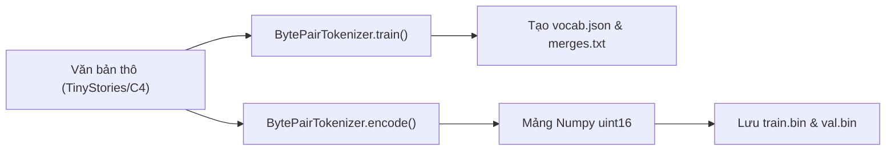
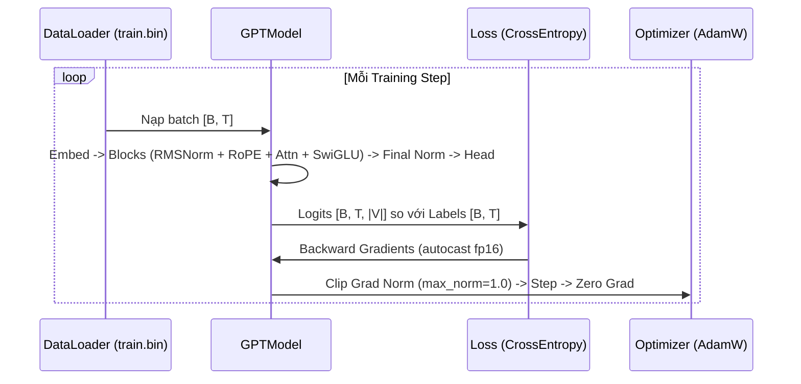
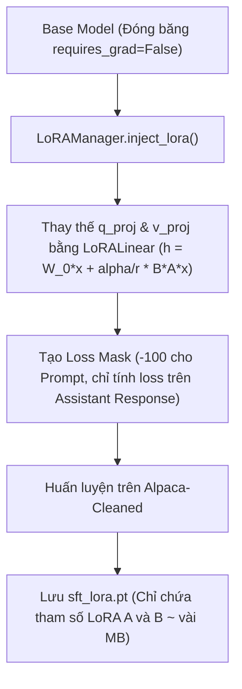
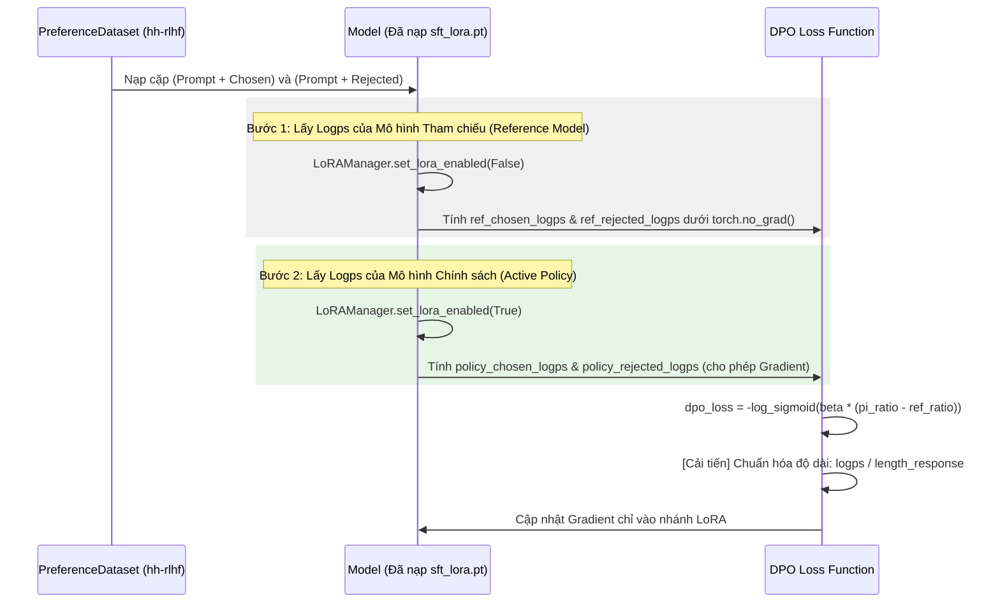
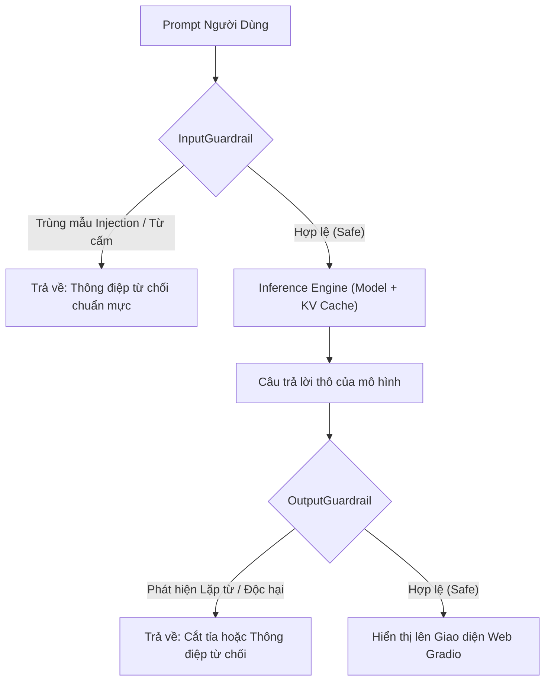

# CHI TIẾT CÁC LUỒNG HOẠT ĐỘNG VÀ DỮ LIỆU (DETAILED CODE & DATA FLOW)

Tài liệu này giải thích chi tiết luồng xử lý dữ liệu (Data Flow) và luồng thực thi mã nguồn (Execution Flow) của toàn bộ 6 quy trình trong hệ thống.

---

## 1. LUỒNG 1: HUẤN LUYỆN BPE TOKENIZER & ĐÓNG GÓI DỮ LIỆU NHỊ PHÂN

Mục tiêu: Chuyển đổi văn bản thô thành định dạng nhị phân `uint16` để nạp siêu tốc vào GPU.

1. **Huấn luyện từ điển:** Hàm `BytePairTokenizer.train()` đọc tập văn bản mẫu, bắt đầu từ 256 byte cơ bản, đếm tần suất cặp byte liền kề và lặp lại thao tác ghép cặp có tần suất cao nhất cho đến khi đạt kích thước `vocab_size` (8,192 tokens).
2. **Đăng ký Special Tokens:** Bổ sung các token hệ thống: `<|pad|>`, `<|bos|>`, `<|eos|>`, `<|user|>`, `<|assistant|>`.
3. **Tuần tự hóa:** Lưu từ điển sang `checkpoints/vocab.json` và các quy tắc sang `checkpoints/merges.txt`.
4. **Token hóa hàng loạt:** Đọc văn bản pre-training, chuyển thành mảng `np.uint16` và ghi ra file `data/train.bin`.

---

## 2. LUỒNG 2: TIỀN HUẤN LUYỆN BASE MODEL & ĐO ĐẠC KV CACHE PROFILING

Mục tiêu: Đạt được mô hình nền tảng có khả năng Next-Token Prediction và chứng minh định lượng hiệu quả giảm độ phức tạp từ $O(T^2)$ về $O(T)$ của KV Cache.

### Luồng Suy luận: Tắt vs Bật KV Cache
- **Khi TẮT KV Cache:** Mỗi khi sinh token thứ $t$, mô hình phải nạp lại toàn bộ chuỗi $1 \dots t$, tính lại Attention trên toàn bộ lịch sử $\rightarrow$ Độ phức tạp thời gian $O(T^2)$.
- **Khi BẬT KV Cache:**
  1. *Pha Prefill:* Xử lý prompt độ dài ban đầu $L$, lưu tensor $K$ và $V$ của từng tầng vào `KVCache`.
  2. *Pha Decode:* Tại mỗi bước tiếp theo, tensor đầu vào chỉ có $T=1$. `CausalSelfAttention` chỉ chiếu 1 token mới, sau đó gọi `kv_cache.update(k, v)` để nối vào đuôi tensor cũ và tính Attention $\rightarrow$ Độ phức tạp thời gian giảm xuống $O(T)$.
- **Đo đạc Profiling:** Script `scripts/profile_kv.py` dùng `torch.cuda.synchronize()` đo chính xác tại $L \in \{128, 512, 1024, 2048\}$ để vẽ đồ thị so sánh Tokens/s, TTFT, TPOT và VRAM.

---

## 3. LUỒNG 3: TIÊM LORA & HUẤN LUYỆN SFT (INSTRUCTION TUNING)

Mục tiêu: Dạy mô hình biết tuân thủ chỉ dẫn hỏi - đáp, đồng thời chỉ cập nhật dưới 3% tham số.

1. **Chuẩn hóa Chat Template & Đồng bộ Inference:**
   - Định dạng mỗi mẫu hội thoại thành: `<|user|>{prompt}<|assistant|>{response}<|eos|>`.
   - `BytePairTokenizer.apply_chat_template()` hỗ trợ `add_generation_prompt=True` khi suy luận để tự động chèn `<|assistant|>` ở cuối, loại bỏ hoàn toàn Training-Serving Skew.
2. **Tạo Mặt Nạ Bỏ Qua (Target Loss Masking):**
   - Lớp `SFTDataCollator` tách biệt ranh giới prompt `<|user|>{prompt}<|assistant|>` và completion `{response}<|eos|>`.
   - Toàn bộ token prompt và padding `<|pad|>` được gán nhãn `-100`.
   - Khi tính `nn.CrossEntropyLoss(ignore_index=-100)`, gradient tại các vị trí này bị triệt tiêu bằng 0.0 tuyệt đối.
   - **Bảo tồn Stop Token:** Token `<|eos|>` của Assistant bắt buộc giữ nguyên nhãn token ID thực tế (không bị mask) để mô hình học cách dừng sinh câu trả lời đúng lúc.
3. **Tiết kiệm tài nguyên:** Chỉ có hai ma trận $A \in \mathbb{R}^{r \times d}$ và $B \in \mathbb{R}^{d \times r}$ của các khối LoRA được tính gradient.

---

## 4. LUỒNG 4: CĂN CHỈNH DPO TỐI ƯU VRAM (REFERENCE-FREE VIA LORA TOGGLE)

Mục tiêu: Căn chỉnh mô hình theo tiêu chí 3H (Helpful, Honest, Harmless) mà không cần huấn luyện Reward Model riêng và tiết kiệm 50% VRAM.

- **Mẹo Tiết kiệm 50% VRAM:** Thay vì phải nạp 2 mô hình (Reference Model và Policy Model) đồng thời lên VRAM, hệ thống dùng **1 mô hình duy nhất**:
  - Tắt LoRA $\rightarrow$ Trở thành Reference Model $\pi_{\text{ref}}$.
  - Bật LoRA $\rightarrow$ Trở thành Policy Model $\pi_\theta$.
- **Giám sát:** Log liên tục chỉ số **Implicit Reward Margin** $\Delta r = r(y_w) - r(y_l)$. Khi mô hình học tốt, $\Delta r$ sẽ tăng dần và tỷ lệ đoán đúng câu Chosen đạt > 70–80%.

---

## 5. LUỒNG 5: MÀNG BỌC BẢO VỆ AN TOÀN 2 TẦNG (HYBRID GUARDRAILS)

Mục tiêu: Đảm bảo mô hình không bị tấn công Jailbreak hoặc phát sinh nội dung độc hại.

- **Tầng 1 (Fast Heuristic Input Guard):** Rà quét nhanh (< 1ms) bằng Regex và Blacklist để chặn đứng các câu lệnh bẻ khóa hệ thống phổ biến (*"Ignore all previous instructions"*, *"System override"*).
- **Tầng 2 (Deep Output Guard):** Rà soát câu trả lời vừa sinh ra để phát hiện lỗi suy sụp lặp từ vô tận (*repetition collapse*) và nội dung nguy hại.

---

## 6. LUỒNG 6: ĐIỀU PHỐI SUY LUẬN TRÊN GIAO DIỆN GRADIO (FRONTEND RUNTIME)

Khi người dùng thao tác trên Web UI:
1. Giao diện `frontend/components/chat_tab.py` tiếp nhận `prompt` và các thanh trượt (`temperature`, `top_p`, `use_kv_cache`, `use_guardrails`).
2. Gửi yêu cầu tới `InferenceEngine.generate()`.
3. `InferenceEngine` thực thi tuần tự: `GuardrailPipeline` $\rightarrow$ `BytePairTokenizer.encode()` $\rightarrow$ `GPTModel.forward()` có `KVCache` $\rightarrow$ `Sampler.sample_next_token()` $\rightarrow$ `BytePairTokenizer.decode()`.
4. Trả về kết quả văn bản kèm các chỉ số: Thời gian trễ (Latency ms), Tốc độ sinh từ (Tokens/giây), Trạng thái an toàn (Guardrail Status) lên giao diện.
