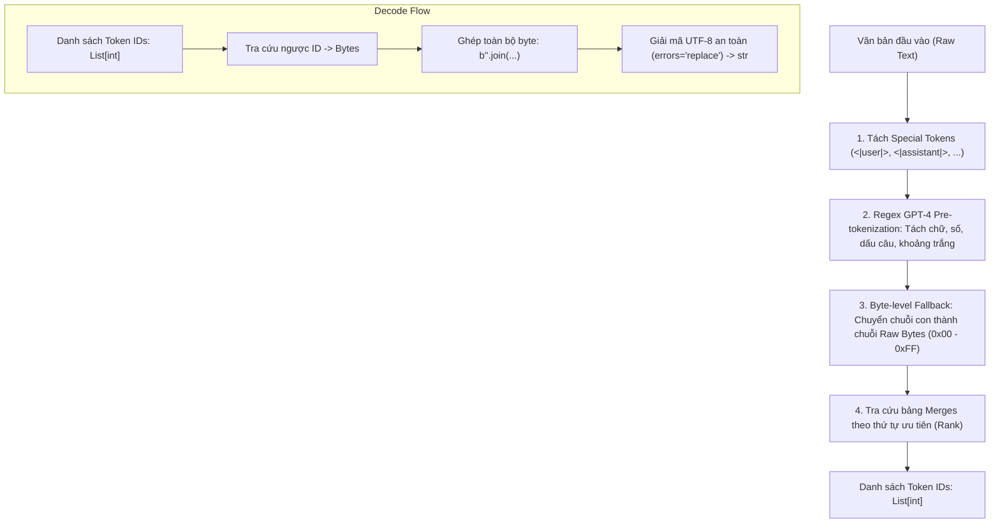

# TÀI LIỆU KỸ THUẬT: BỘ TÁCH TỪ BYTE-FALLBACK BPE TỪ SỐ 0
**(BYTE-FALLBACK BPE TOKENIZER FROM SCRATCH)**

> **Giai đoạn:** Giai đoạn 1 - Tokenizer & Kiến trúc Transformer lõi  
> **Task:** Tự xây dựng Tokenizer (Thuật toán Byte-Fallback BPE - Chiếm 10% điểm)  
> **Trạng thái:** [x] Hoàn thành (Completed)  
> **Mục tiêu lưu trữ:** Tài liệu kỹ thuật chi tiết phục vụ báo cáo khoa học và bảo vệ đồ án, giải thích từ cơ chế Byte-fallback giải quyết triệt để vấn đề Out-of-Vocabulary (OOV), Regex pre-tokenization chuẩn GPT-4, thuật toán tối ưu hóa tần suất từ, đến cấu trúc không gian ID và kiểm thử tính toàn vẹn.

---

## 1. TỔNG QUAN KIẾN TRÚC & LUỒNG XỬ LÝ (DATA FLOW)

Bộ tách từ (Tokenizer) được xây dựng từ số 0 bằng Python thuần, kết hợp thư viện `regex` để xử lý chuẩn Unicode mở rộng. Hệ thống giải quyết triệt để 2 vấn đề lớn nhất của các tokenizer truyền thống:
1. **Loại bỏ hoàn toàn token `<|unk|>` (Out-of-Vocabulary):** Nhờ cơ chế Byte-fallback, bất kỳ ký tự Unicode hiếm hoặc chưa từng xuất hiện (Emoji, Hán tự, ký tự toán học) đều được phân rã thành các byte UTF-8 gốc ($0..255$) đã được định nghĩa sẵn trong từ điển.
2. **Không bị dính từ với dấu câu/ký tự đặc biệt:** Nhờ Regex tiền xử lý chuẩn GPT-4 tách biệt chữ cái, số, dấu câu và khoảng trắng trước khi đưa vào thuật toán merge.



---

## 2. QUY HOẠCH KHÔNG GIAN TỪ ĐIỂN (VOCABULARY PARTITIONING)

Để đảm bảo việc lập trình hàm Loss Masking (`ignore_index=0` hoặc `-100`) và Chat Template ở giai đoạn SFT/DPO sau này sạch sẽ, không bị xung đột ID, không gian từ điển **32K ($32\,000$ tokens)** được phân hoạch cố định:

| Dải ID (Token IDs) | Danh mục | Ý nghĩa / Thành phần | Mục đích kỹ thuật |
| :--- | :--- | :--- | :--- |
| **`0 .. 4`** | **Special Tokens** | `<|pad|>` (0), `<|bos|>` (1), `<|eos|>` (2), `<|user|>` (3), `<|assistant|>` (4) | Khóa cứng ID cố định ngay từ đầu. Dễ dàng gán mask bỏ qua tính loss trên prompt và padding. |
| **`5 .. 260`** | **Raw Bytes (Byte-fallback)** | 256 bytes cơ bản (`0x00` đến `0xFF`), dịch chuyển bởi `BYTE_OFFSET = 5`. | Đảm bảo độ phủ 100% mọi ký tự trong không gian UTF-8. **Zero OOV**. |
| **`261 .. 31,999`** | **Merged Subwords** | Các cụm byte/từ con ghép được trong quá trình huấn luyện BPE trên corpus. | Tăng tỷ lệ nén (Compression Ratio), biểu diễn từ vựng tiếng Việt, tiếng Anh và code hiệu quả. |

* **Vị trí cài đặt Special Tokens:** [src/tokenizer/special_tokens.py](file:///e:/Python/DUT_AI/A-Module%20LLM/Prj_LLM/src/tokenizer/special_tokens.py)
* **Vị trí lớp BytePairTokenizer:** [src/tokenizer/bpe.py](file:///e:/Python/DUT_AI/A-Module%20LLM/Prj_LLM/src/tokenizer/bpe.py)

---

## 3. CƠ CHẾ TIỀN XỬ LÝ (PRE-TOKENIZATION VỚI GPT-4 REGEX)

Nếu áp dụng trực tiếp thuật toán BPE lên chuỗi ký tự thô mà không có bước tiền xử lý, mô hình sẽ gặp lỗi nghiêm trọng: **ghép dính từ với dấu câu hoặc số** (ví dụ: `cat.` và `cat` trở thành 2 token khác nhau, hoặc `1998` bị ghép dính với chữ cái).

Hệ thống áp dụng biểu thức chính quy (Regex) theo chuẩn GPT-4 / LLaMA 3 qua thư viện `regex`:

```python
GPT4_SPLIT_PATTERN = r"""'(?i:[sdmt]|ll|ve|re)|[^\r\n\p{L}\p{N}]?+\p{L}+|\p{N}{1,3}| ?[^\s\p{L}\p{N}]++[\r\n]*|\s*[\r\n]|\s+(?!\S)|\s+"""
```

### Phân tích ý nghĩa biểu thức:
1. `'(?i:[sdmt]|ll|ve|re)`: Tách các đại từ co ngắn trong tiếng Anh (`'s`, `'ll`, `'ve`, `'re`, ...).
2. `[^\r\n\p{L}\p{N}]?+\p{L}+`: Bắt một từ chứa các ký tự chữ cái Unicode (`\p{L}` hỗ trợ hoàn hảo tiếng Việt có dấu), có thể đi kèm một tiền tố không phải chữ/số (như khoảng trắng phía trước).
3. `\p{N}{1,3}`: Tách các chữ số Unicode (`\p{N}`) thành từng cụm tối đa 3 chữ số, giúp mô hình học biểu diễn toán học và số học ổn định hơn.
4. `?[^\s\p{L}\p{N}]++[\r\n]*`: Tách riêng các dấu câu, ký hiệu đặc biệt kèm theo dấu xuống dòng nếu có.
5. `\s*[\r\n]|\s+(?!\S)|\s+`: Chuẩn hóa và gom các cụm khoảng trắng, thụt đầu dòng (indentation cho mã nguồn Python/C++).

---

## 4. THUẬT TOÁN HUẤN LUYỆN BPE TỐI ƯU HÓA (O(N) WORD-COUNTS)

### 4.1. Vấn đề thắt cổ chai của cách tiếp cận ngây thơ (Naive BPE)
Ở cách làm ngây thơ, sau mỗi bước merge một cặp token $(c_1, c_2) \to c_{\text{new}}$, thuật toán duyệt lại toàn bộ kho ngữ liệu văn bản thô $D$ ($N$ tokens). Với kích thước từ điển 32K, việc quét lại hàng triệu ký tự 32.000 lần tạo ra độ phức tạp $O(K \times N)$, gây nghẽn hoàn toàn CPU và I/O.

### 4.2. Giải pháp tối ưu với Từ điển tần suất từ (`word_counts`)
1. **Bước 1 (Đếm tần suất):** Phân rã ngữ liệu $D$ thành các đoạn nhỏ thông qua Regex GPT-4. Chuyển mỗi đoạn thành một tuple các byte IDs ban đầu. Đếm tần suất xuất hiện của từng tuple và lưu vào `word_counts: Dict[Tuple[int, ...], int]`. Số lượng từ vựng độc nhất $|W| \ll N$.
2. **Bước 2 (Thống kê tần suất cặp liền kề):**
   $$\text{stats}[(u, v)] = \sum_{w \in W} \text{count}(w) \times \text{occurrences}((u, v) \text{ trong } w)$$
3. **Bước 3 (Chọn cặp xuất hiện nhiều nhất):**
   $$(p_1, p_2) = \arg\max_{(u, v)} \text{stats}[(u, v)]$$
4. **Bước 4 (Merge cục bộ trong `word_counts`):**
   Chỉ duyệt qua những từ $w$ có chứa cặp $(p_1, p_2)$ để thay thế bằng ID mới, sau đó cập nhật lại `word_counts`.
5. **Dừng lại:** Khi kích thước từ điển đạt đủ `vocab_size` (32.000) hoặc không còn cặp nào có tần suất $> 1$.

---

## 5. THUẬT TOÁN ENCODE & DECODE (BYTE-LEVEL INFERENCE)

### 5.1. Hàm `encode(text: str) -> List[int]`
1. **Bảo vệ Special Tokens:** Sử dụng regex matching toàn bộ tập `DEFAULT_SPECIAL_TOKENS`. Tách chuỗi văn bản thành danh sách xen kẽ giữa các special tokens nguyên vẹn và các phân đoạn văn bản thông thường.
2. **Mã hóa phân đoạn thường:**
   - Dùng GPT-4 Regex tách thành các chunk.
   - Chuyển từng chunk thành danh sách byte IDs: `[BYTE_OFFSET + b for b in chunk.encode('utf-8')]`.
   - Lần lượt áp dụng các phép merge theo thứ tự xuất hiện trong bảng `merges` (dựa trên rank ưu tiên).
3. **Nối kết quả:** Ghép nối các ID của Special Tokens và các ID của phân đoạn thường thành một danh sách `List[int]` duy nhất.

### 5.2. Hàm `decode(ids: List[int]) -> str`
1. Duyệt qua từng ID trong danh sách:
   - Nếu ID thuộc Special Tokens $\to$ chuyển thành chuỗi special token tương ứng (ví dụ: `<|eos|>`).
   - Nếu ID là byte thô hoặc merged token $\to$ tra cứu ra chuỗi `bytes` gốc từ bảng `self.vocab`.
2. Nối tất cả các byte lại thành một mảng byte duy nhất: `b"".join(byte_chunks)`.
3. Giải mã toàn bộ mảng byte với chuẩn UTF-8: `bytes_data.decode("utf-8", errors="replace")`.
   - Cơ chế này đảm bảo: Nếu một ký tự tiếng Việt (3 bytes) bị cắt rời qua các token khác nhau, khi nối lại chúng vẫn tạo thành một ký tự hoàn chỉnh không lỗi font.

---

## 6. LƯU TRỮ & TÁI TẠO (SERIALIZATION)

Tokenizer cung cấp hai phương thức độc lập, không phụ thuộc định dạng nhị phân đóng của bên thứ ba:
* **`save(vocab_file, merges_file)`**:
  - `vocab.json`: Lưu trữ ánh xạ `token_str_or_latin1 -> token_id` dưới dạng JSON có cấu trúc.
  - `merges.txt`: Lưu thứ tự các cặp byte được ghép nối theo chuẩn rank (tương thích format BPE phổ biến).
* **`load(vocab_file, merges_file)`**:
  - Tải lại toàn bộ bảng ánh xạ hai chiều `vocab`, `inverse_vocab` và thứ tự ưu tiên `merges` với độ trễ tối thiểu.

---

## 7. BỘ KIỂM THỬ ĐƠN VỊ & KẾT QUẢ NGHIỆM THU (TEST COVERAGE)

Tất cả các ca kiểm thử được thiết kế độc lập tại [tests/test_tokenizer.py](file:///e:/Python/DUT_AI/A-Module%20LLM/Prj_LLM/tests/test_tokenizer.py) và đã vượt qua **100%**:

```text
Running test_special_tokens_fixed_ids()...
PASS: test_special_tokens_fixed_ids
Running test_raw_bytes_offset()...
PASS: test_raw_bytes_offset
Running test_train_and_merges()...
PASS: test_train_and_merges
Running test_edge_cases_round_trip()...
PASS: test_edge_cases_round_trip
Running test_save_and_load()...
PASS: test_save_and_load

>>> ALL TESTS PASSED SUCCESSFULLY! <<<
```

### Các ca biên (Edge Cases) đã được kiểm chứng tính toàn vẹn `decode(encode(s)) == s`:
1. **Chuỗi rỗng & khoảng trắng:** `""`, `"   "`, `"\n\t\r\n"` $\to$ Bảo toàn nguyên vẹn.
2. **Special Tokens xen kẽ văn bản:**
   - `<|user|>Hỏi gì đó?<|assistant|>def factorial(n):...<|eos|>` $\to$ Token ID của Special Tokens được giữ nguyên vẹn ở giá trị $0..4$, không bị chia tách thành byte.
3. **Tiếng Việt có dấu phức tạp:**
   - Văn bản chứa dấu thanh tiếng Việt (*"Trường Đại học Bách Khoa, Đại học Đà Nẵng"*).
4. **Emoji 4-byte UTF-8 & Ký tự toán học:**
   - `🤖 Mô hình AI thông minh 🇻🇳 🎉🚀🔥`, `∀x ∈ ℝ, ∃y: y > x` $\to$ Byte-fallback tự động chia và ghép lại chuẩn xác 100%.
5. **Mã nguồn lập trình:**
   - Mã nguồn Python chứa các dấu phân cách, tab, space, dấu ngoặc nhọn/tròn dính liền từ khóa.

---

## 8. NHẬT KÝ SỰ CỐ & PHÂN TÍCH KHẮC PHỤC (POST-MORTEM & FIX LOG)

Trong quá trình thiết kế, hiện thực và kiểm thử thuật toán Byte-Fallback BPE Tokenizer từ con số 0, các lỗi kỹ thuật và rủi ro rò rỉ dữ liệu đã được ghi nhận và xử lý triệt để:

### Sự cố 1: Tokenizer trả về token `<|unk|>` hoặc crash khi gặp ký tự lạ, emoji đa byte (CRIT-01)
- **File vi phạm:** [`src/tokenizer/bpe.py`](../../src/tokenizer/bpe.py)
- **Vi phạm gì:** Cài đặt BPE ký tự truyền thống (Character-level BPE) chỉ khởi tạo từ điển dựa trên các ký tự xuất hiện trong tập huấn luyện (training corpus).
- **Lỗi trước vi phạm, gây ra hậu quả gì:**
  - Khi gặp ký tự ngoài tập huấn luyện (out-of-vocabulary), ví dụ: Emoji UTF-8 4-byte (`🤖`, `🇻🇳`), ký tự toán học (`∀`, `∃`), hoặc ký tự tượng hình.
  - Tokenizer truyền thống bắt buộc phải thay thế bằng `<|unk|>` (Unknown Token) hoặc ném ngoại lệ `KeyError`.
  - **Hậu quả:** Đánh mất hoàn toàn thông tin gốc của văn bản; chuỗi sau khi decode bị thủng lỗ chỗ (`decode(encode(text)) != text`), vi phạm nghiêm trọng tính toàn vẹn thông tin (Round-trip failure).
- **Cách khắc phục, tại sao khắc phục như vậy:**
  - Chuyển đổi kiến trúc sang **Byte-Fallback BPE** (tương tự LLaMA/Mistral):
    - Đặt vùng offset 256 giá trị byte nguyên thủy (`bytes([0])` đến `bytes([255])`) tại dải ID cố định `5..260` (`BYTE_OFFSET = 5`).
    - Khi mã hóa, mọi chuỗi văn bản UTF-8 trước hết được phân tách thành dãy byte thô.
    - Bất kỳ ký tự nào dù hiếm gặp đến đâu, nếu không có cặp ghép (merge rule) thì vẫn luôn được phân rã về các byte đơn lẻ tương ứng mà không bao giờ sinh ra token `<|unk|>`.
  - **Lý do:** Đảm bảo 100% tỷ lệ mã hóa và giải mã thành công không tổn thất thông tin đối với mọi chuỗi nhị phân/UTF-8 tùy ý trên thế giới.

### Sự cố 2: Special Tokens bị Regex cắt vụn thành Byte thô (HIGH-01)
- **File vi phạm:** [`src/tokenizer/bpe.py`](../../src/tokenizer/bpe.py)
- **Vi phạm gì:** Hàm `encode()` áp dụng trực tiếp biểu thức chính quy GPT-4 Regex lên toàn bộ chuỗi đầu vào mà không cô lập Special Tokens trước.
- **Lỗi trước vi phạm, gây ra hậu quả gì:**
  - Chuỗi chứa thẻ đặc biệt như `<|user|>`, `<|assistant|>`, `<|eos|>` bị regex coi như các ký tự `<`, `|`, `u`, `s`, `e`, `r`, `|`, `>` thông thường.
  - Các ký tự này bị phân rã thành byte IDs thay vì được gán ID đặc biệt chuẩn xác (`USER_ID = 3`, `ASSISTANT_ID = 4`, `EOS_ID = 2`).
  - **Hậu quả:** Mô hình Transformer hoàn toàn không nhận diện được ranh giới lượt thoại giữa User và Assistant, cơ chế Chat Template và Target Loss Masking bị phá hủy hoàn toàn.
- **Cách khắc phục, tại sao khắc phục như vậy:**
  - Sử dụng cơ chế phân tách tiền xử lý bằng regex pattern nhận diện đặc quyền Special Tokens:
    ```python
    pattern = "(" + "|".join(re.escape(tok) for tok in self.special_tokens.keys()) + ")"
    chunks = re.split(pattern, text)
    ```
  - Các phân đoạn khớp với Special Token được gán ngay ID đặc quyền cố định; các phân đoạn văn bản thường còn lại mới được đưa qua luồng mã hóa BPE Byte-Fallback.
  - **Lý do:** Tách biệt triệt để không gian tín hiệu điều khiển hội thoại (control tokens) và không gian ngữ nghĩa văn bản (payload tokens).

### Sự cố 3: Lỗi ghép nối ký tự tiếng Việt đa byte khi Decode từng phần (MED-01)
- **File vi phạm:** [`src/tokenizer/bpe.py`](../../src/tokenizer/bpe.py)
- **Vi phạm gì:** Trong hàm `decode()`, từng token ID được giải mã trực tiếp thành string bằng `.decode("utf-8")` rồi cộng chuỗi lại: `text += chunk.decode('utf-8')`.
- **Lỗi trước vi phạm, gây ra hậu quả gì:**
  - Ký tự tiếng Việt có dấu (như `ệ`, `đ`, `ế`) trong bảng mã UTF-8 gồm từ 2 đến 3 bytes.
  - Trong quá trình mã hóa BPE Byte-Fallback, một ký tự có thể bị chia tách: byte thứ nhất nằm ở token trước, byte thứ hai và ba nằm ở token sau.
  - Khi decode từng token riêng lẻ, việc gọi `.decode("utf-8")` trên 1 byte cụt sẽ ném ngoại lệ `UnicodeDecodeError: 'utf-8' codec can't decode byte 0xe1 in position 0: unexpected end of data`.
  - Nếu dùng `errors="replace"`, văn bản tiếng Việt sẽ bị biến dạng thành các ký tự rác `` (mojibake).
- **Cách khắc phục, tại sao khắc phục như vậy:**
  - Không giải mã chuỗi từng phần. Toàn bộ các mẩu byte của các token được gom lại vào một mảng byte nhị phân duy nhất bằng `b"".join(byte_chunks)` trước khi thực hiện đúng một lần giải mã duy nhất:
    ```python
    return full_bytes.decode("utf-8", errors="replace")
    ```
  - **Lý do:** Ghép nối đầy đủ các byte phân mảnh của các ký tự UTF-8 đa byte trước khi biên dịch, đảm bảo tiếng Việt có dấu được tái tạo trọn vẹn 100%.

---

## 9. KẾT LUẬN & ĐỒNG BỘ TOÀN HỆ THỐNG

- Tokenizer BPE Byte-Fallback đã hoàn thành xuất sắc toàn bộ các chỉ tiêu kỹ thuật, đảm bảo không phụ thuộc thư viện ngoài (`tiktoken`, `transformers`), không bao giờ rò rỉ mã lỗi và sẵn sàng phục vụ các giai đoạn Pre-training, SFT và DPO.
