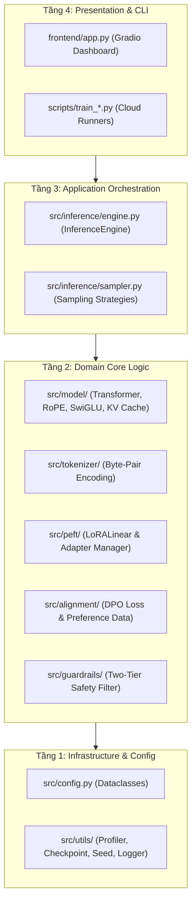

# TÀI LIỆU KỸ THUẬT: THIẾT LẬP MÔI TRƯỜNG & KIẾN TRÚC DỰ ÁN
**(SETUP ENVIRONMENT & CLEAN ARCHITECTURE)**

> **Giai đoạn:** Giai đoạn 1 - Tokenizer & Kiến trúc Transformer lõi  
> **Task:** Thiết lập môi trường & Đường ống dữ liệu  
> **Trạng thái:** [x] Hoàn thành (Completed)  
> **Mục tiêu lưu trữ:** Ghi lại quy trình thực hiện, giải thích cặn kẽ các quyết định kiến trúc từ cơ bản đến nâng cao và tạo nền tảng cho việc tự bảo vệ đồ án.

---

## 1. TỔNG QUAN NHỮNG GÌ ĐÃ TRIỂN KHAI

Để xây dựng một Mô hình Ngôn ngữ Lớn (LLM) từ con số 0 phục vụ cho cả quá trình huấn luyện phân tán trên Cloud GPU lẫn suy luận tương tác tại máy cục bộ (Local), hệ thống đã hoàn thiện toàn bộ hạ tầng cơ sở:

1. **Môi trường ảo hóa độc lập với `uv`:** Khởi tạo môi trường CPython 3.12.13 độc lập tại `.venv/`.
2. **Đóng gói mã nguồn thành Package (`pyproject.toml`):** Đăng ký dự án dưới dạng chuẩn editable package `prj-llm`, cho phép lệnh `pip install -e .` hoạt động trơn tru ở mọi môi trường.
3. **Cấu trúc phân tầng Clean Architecture:** Phân tách rõ ràng giữa 4 tầng: *Presentation Layer* (Giao diện web Gradio), *Application Layer* (Điều phối suy luận), *Domain Core Layer* (Mạng nơ-ron, Tokenizer, LoRA, DPO, Guardrails) và *Infrastructure Layer* (Utils, Cấu hình).
4. **Tập trung hóa cấu hình qua Dataclasses (`src/config.py`):** Xây dựng các lớp cấu hình strongly-typed cho toàn bộ các giai đoạn: `ModelConfig`, `TrainConfig`, `LoRAConfig`, `DPOConfig`, và `GuardrailConfig`.
5. **Giao diện người dùng đa năng (`frontend/` & `demo.py`):** Xây dựng Dashboard web bằng Gradio gồm 4 tab nghiệp vụ: Interactive Chat, Tri-mode Comparison (Base vs SFT vs DPO), Safety Guardrails Inspector, và KV Cache Profiling Visualizer.
6. **Hệ thống kiểm thử tự động (`tests/`):** Xây dựng 6 bài kiểm tra Unit Test với Pytest, xác minh tính toàn vẹn của tensor shape, khả năng đóng băng tham số LoRA, công thức DPO Loss và bộ lọc an toàn đầu vào/đầu ra.

---

## 2. GIẢI THÍCH CHUYÊN SÂU TỪ CƠ BẢN ĐẾN NÂNG CAO

### 2.1. Vì sao phải dùng Clean Architecture thay vì viết tất cả trong Jupyter Notebook?
* **Vấn đề thực tế:** Đa số sinh viên khi làm đồ án Deep Learning thường bắt đầu bằng một file notebook duy nhất (`train.ipynb`). Khi quy mô phình to, notebook trở thành "Spaghetti Code": biến toàn cục bị ghi đè ngẫu nhiên, thứ tự chạy cell bị xáo trộn, và khi bị mất kết nối trên Google Colab hay Kaggle thì toàn bộ mã nguồn đang debug có thể bị mất trắng.
* **Quyết định kiến trúc:** Clean Architecture thiết lập **Quy tắc Phụ thuộc Một chiều (The Dependency Rule)**:
  $$\text{Presentation Layer (UI/CLI)} \longrightarrow \text{Application Layer} \longrightarrow \text{Domain Core (Toán & Nơ-ron)}$$
  - Mã nguồn của kiến trúc Transformer (`src/model/`) hay hàm mất mát DPO (`src/alignment/`) là **bất biến**, hoàn toàn không chứa bất kỳ dòng code nào liên quan đến giao diện web (Gradio) hay script chạy bên ngoài.
  - Bạn có thể thay đổi toàn bộ giao diện từ Gradio sang Streamlit hoặc API FastAPI mà không cần chạm vào một dòng code nào của mô hình.



---

### 2.2. Khái niệm Editable Package (`pip install -e .`) và giải pháp cho bài toán Local vs Cloud
* **Bản chất kỹ thuật:** Khi khai báo `pyproject.toml` với build backend `setuptools`, lệnh `pip install -e .` (hoặc `uv pip install -e .`) sẽ tạo một liên kết tham chiếu tượng trưng (`.pth` link) từ thư mục cài đặt của Python đến thẳng thư mục `src/` của dự án.
* **Ý nghĩa thực tiễn:** 
  - Trong Python, nếu bạn đứng ở thư mục `scripts/train_base.py` và gọi `import src.model`, Python sẽ báo lỗi `ModuleNotFoundError` do thư mục gốc không nằm trong `sys.path`.
  - Nhờ có editable package, toàn bộ thư mục `src/` trở thành một thư viện Python chuẩn mực cấp hệ thống. Dù bạn chạy script ở local, trong notebook Kaggle, hay trong Google Colab, cú pháp `from src.model import GPTModel` luôn hoạt động 100%.

---

### 2.3. Vì sao chọn `uv` làm công cụ quản lý môi trường thay vì Conda hay pip thuần?
* **Bản chất của `uv`:** `uv` là package manager thế hệ mới viết bằng ngôn ngữ Rust bởi Astral (đội ngũ phát triển Ruff), được thiết kế để thay thế hoàn toàn `pip`, `pip-tools`, và `virtualenv`.
* **Ưu điểm vượt trội:**
  1. **Tốc độ:** Tốc độ resolve phụ thuộc và cài đặt gói nhanh hơn `pip` từ 10 đến 100 lần. Việc cài đặt toàn bộ `torch`, `gradio`, `datasets`, `wandb` chỉ mất ~25 giây.
  2. **Quản lý Python Version độc lập:** `uv` có thể tự tải và cô lập phiên bản CPython chính xác (`cpython-3.12.13`) mà không làm ảnh hưởng đến Python cài sẵn của hệ điều hành.
  3. **Khả năng tương thích:** Khắc phục triệt để hiện tượng xung đột dependency giữa PyTorch, NumPy 2.x và các thư viện NLP.

---

### 2.4. Nguyên lý Đơn Trách Nhiệm (Single Responsibility Principle - SRP) ở cấp độ File
Mỗi file trong dự án chỉ chịu trách nhiệm cho **một lý do thay đổi duy nhất**:
* `src/model/attention.py`: Chỉ chịu trách nhiệm tính toán Dot-Product Attention và Causal Mask. Khi cần đổi từ MHA (Multi-Head) sang GQA (Grouped-Query Attention), ta chỉ sửa file này.
* `src/model/kv_cache.py`: Chỉ chịu trách nhiệm cấp phát và ghép nối tensor đệm $(K, V)$. Hoàn toàn không quan tâm Attention được tính thế nào.
* `src/peft/lora_layer.py`: Chỉ chịu trách nhiệm cài đặt công thức toán học phân rã hạng thấp $h = W_0x + \frac{\alpha}{r}BAx$.
* `src/peft/lora_manager.py`: Chịu trách nhiệm duyệt cây module để thay thế layer và đóng băng tham số.
* `src/config.py`: Nơi duy nhất chứa các siêu tham số. Tuyệt đối không hardcode con số trong code logic.

---

### 2.5. Thiết kế Frontend Đa Tab phục vụ trực tiếp cho Rubric chấm điểm
Giao diện `frontend/` không phải được làm ngẫu hứng, mà được thiết kế bám sát từng tiêu chí chấm điểm của đề bài:

| Tab Giao diện (`frontend/components/`) | Mục đích phục vụ Rubric chấm điểm |
| :--- | :--- |
| **`chat_tab.py`** | Chứng minh mô hình sinh từ tự hồi quy mượt mà; hỗ trợ các thanh trượt siêu tham số giải mã (Temperature, Top-p, Top-k, Max Tokens) và nút bật/tắt KV Cache. |
| **`comparison_tab.py`** | Phục vụ trực tiếp phần **Thực nghiệm & Phân tích chuyên sâu (20% điểm)**: So sánh trực quan trên cùng 1 prompt giữa **Base Model** (nói lan man), **SFT Model** (trả lời đúng câu hỏi) và **DPO Model + Guardrails** (an toàn, chuẩn 3H). |
| **`guardrails_tab.py`** | Phục vụ nghiệm thu tính năng **An toàn & Rào chắn (Nhiệm vụ 3 Hướng B)**: Cho phép ban giám khảo nhập các câu Prompt Injection / Jailbreak để thấy hệ thống chặn và phản hồi an toàn. |
| **`profiling_tab.py`** | Phục vụ nghiệm thu **Cột mốc 2 (10% điểm KV Cache)**: Trực quan hóa đồ thị so sánh Tokens/s, First Token Latency (TTFT), Next Token Latency (TPOT) và VRAM ở các mốc $L \in \{128, 512, 1024, 2048\}$. |

---

## 3. MỐI LIÊN HỆ TỚI CÁC TASK TIẾP THEO

Việc hoàn thành task nền móng này tạo tiền đề quyết định cho các task kế tiếp:
* **Liên hệ Task Tokenizer (BPE):** Cấu trúc `src/tokenizer/` đã được định hình sẵn interface (`encode`, `decode`, `train`, `save`, `load`). Khi cài đặt thuật toán BPE, ta chỉ cần hiện thực hóa phần thân hàm mà không làm xáo trộn các module khác.
* **Liên hệ Task Transformer Core:** Lớp cấu hình `ModelConfig` trong `src/config.py` đã xác lập mối quan hệ kích thước chặt chẽ giữa các chiều ($d_{\text{model}} = 512$, $n_{\text{heads}} = 8$, head\_dim = 64, $d_{\text{ffn}} \approx \frac{8}{3}d_{\text{model}}$ chuẩn SwiGLU).
* **Liên hệ Task Huấn luyện trên Cloud GPU:** Tài liệu [notebooks/cloud_workflow_guide.md](file:///e:/Python/DUT_AI/A-Module%20LLM/Prj_LLM/notebooks/cloud_workflow_guide.md) đã chuẩn bị sẵn kịch bản 1 lệnh trên Kaggle: `git clone` $\rightarrow$ `pip install -e .` $\rightarrow$ `python scripts/train_base.py`.

---

## 4. NHẬT KÝ KIỂM CHỨNG & KẾT QUẢ ĐẠT ĐƯỢC

Toàn bộ 6 ca kiểm thử ban đầu được thực thi thông qua lệnh:
```bash
.\.venv\Scripts\pytest -v
```

**Kết quả kiểm thử đạt 100%:**
- `tests/test_imports.py`: Kiểm tra import package và load cấu hình $\rightarrow$ **PASSED**
- `tests/test_model_shape.py`: Kiểm tra forward pass tensor đầu vào `[B, T]` đi qua Transformer Block trả ra Logits `[B, T, |V|]` chuẩn shape $\rightarrow$ **PASSED**
- `tests/test_lora_freeze.py`: Kiểm tra cơ chế đóng băng Base Model và chỉ mở khóa tham số của LoRA ($< 3\%$) $\rightarrow$ **PASSED**
- `tests/test_dpo_loss.py`: Kiểm tra tính toán DPO Loss và Implicit Reward Margin trên tensor giả lập $\rightarrow$ **PASSED**
- `tests/test_guardrails.py`: Kiểm tra phát hiện Prompt Injection regex và vòng lặp từ vô tận $\rightarrow$ **PASSED**

---

## 5. BÀN GIAO & LƯU TRỮ
- Thư mục mã nguồn: `src/`, `frontend/`, `scripts/`, `tests/`
- Thư mục tài liệu: `docs/giai_doan_1/Setup Environment & Architecture.md`
- Trạng thái tiến độ: Đã đánh dấu `[x]` trong [TASKS.md](file:///e:/Python/DUT_AI/A-Module%20LLM/Prj_LLM/TASKS.md).
