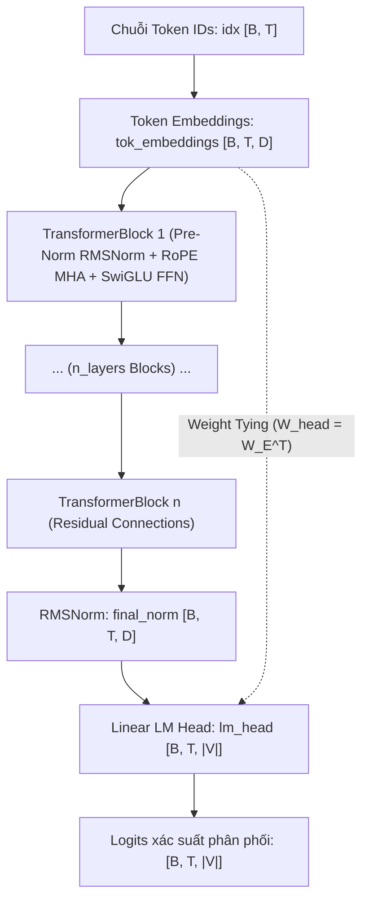

# TÀI LIỆU KỸ THUẬT: KIẾN TRÚC DECODER-ONLY TRANSFORMER TỪ CON SỐ 0
**(DECODER-ONLY TRANSFORMER ARCHITECTURE FROM SCRATCH)**

> **Giai đoạn:** Giai đoạn 1 - Tokenizer & Kiến trúc Transformer lõi  
> **Task:** Lập trình Kiến trúc Decoder-Only Transformer bằng PyTorch thuần  
> **Trạng thái:** [x] Hoàn thành (Completed)  
> **Mục tiêu lưu trữ:** Tài liệu kỹ thuật chi tiết phục vụ báo cáo và bảo vệ đồ án, giải thích từ cơ bản đến chuyên sâu các khối toán học, cơ chế nhúng vị trí, kỹ thuật tối ưu tham số và quy chuẩn khởi tạo.

---

## 1. TỔNG QUAN KIẾN TRÚC TỔNG THỂ

Hệ thống triển khai một kiến trúc **Decoder-Only Transformer** hiện đại theo chuẩn của các mô hình tiên tiến nhất (LLaMA 3, Mistral, Gemma), hoàn toàn viết bằng PyTorch thuần (`torch.nn`), không sử dụng các lớp high-level có sẵn của HuggingFace `transformers`.



---

## 2. GIẢI THÍCH CHI TIẾT CÁC THÀNH PHẦN TOÁN HỌC & MÃ NGUỒN

### 2.1. Chuẩn hóa Root Mean Square (RMSNorm) - Pre-Norm
* **Vị trí cài đặt:** [src/model/layers.py](file:///e:/Python/DUT_AI/A-Module%20LLM/Prj_LLM/src/model/layers.py)
* **Toán học & Nguyên lý:**
  So với chuẩn hóa LayerNorm truyền thống:
  $$\text{LayerNorm}(x) = \frac{x - \mu}{\sqrt{\sigma^2 + \epsilon}} \odot \gamma + \beta$$
  RMSNorm loại bỏ việc tính trung bình $\mu$ (mean-centering) và dịch chuyển $\beta$ (bias offset), chỉ chuẩn hóa dựa trên căn bậc hai trung bình bình phương:
  $$\text{RMS}(x) = \sqrt{\frac{1}{d} \sum_{i=1}^d x_i^2 + \epsilon}, \quad \text{RMSNorm}(x) = \frac{x}{\text{RMS}(x)} \odot \gamma$$
* **Lý do lựa chọn:** Giảm ~7% đến 15% thời gian tính toán trên GPU mà vẫn bảo toàn hoàn toàn tính ổn định phân phối gradient; cấu trúc **Pre-Norm** đảm bảo gradient truyền thẳng (gradient highway) qua các kết nối thặng dư (residual connections).

---

### 2.2. Mã hóa vị trí quay RoPE (Rotary Positional Embedding)
* **Vị trí cài đặt:** [src/model/layers.py](file:///e:/Python/DUT_AI/A-Module%20LLM/Prj_LLM/src/model/layers.py) và [src/model/attention.py](file:///e:/Python/DUT_AI/A-Module%20LLM/Prj_LLM/src/model/attention.py)
* **Toán học & Nguyên lý:**
  RoPE mã hóa vị trí tương đối thông qua phép quay vector trong không gian 2 chiều. Đối với vector Query $q_m$ tại vị trí $m$ và vector Key $k_n$ tại vị trí $n$:
  $$R_{\Theta, m}^d = \text{diag}\left( R_{\theta_1, m}, R_{\theta_2, m}, \dots, R_{\theta_{d/2}, m} \right)$$
  với ma trận quay 2D:
  $$R_{\theta_i, m} = \begin{pmatrix} \cos(m\theta_i) & -\sin(m\theta_i) \\ \sin(m\theta_i) & \cos(m\theta_i) \end{pmatrix}, \quad \theta_i = \text{base}^{-2(i-1)/d}$$
* **Tính chất cốt lõi:**
  Tích vô hướng giữa Query và Key mang bản chất tương đối:
  $$\langle R_{\Theta, m}^d q_m, R_{\Theta, n}^d k_n \rangle = g(q, k, m - n)$$
  Nhờ đó, mô hình tự nhiên suy luận được khoảng cách tương đối $m - n$ giữa các token mà không cần học ma trận nhúng vị trí tuyệt đối (`nn.Embedding(max_len, d_model)`).
* **Bảo toàn chuẩn L2:** Vì ma trận quay trực giao, $\|R x\|_2 = \|x\|_2$.

---

### 2.3. Causal Multi-Head Self-Attention & Mặt nạ Tam giác dưới
* **Vị trí cài đặt:** [src/model/attention.py](file:///e:/Python/DUT_AI/A-Module%20LLM/Prj_LLM/src/model/attention.py)
* **Cơ chế tính toán:**
  1. Chiếu tuyến tính: $Q = X W_q, K = X W_k, V = X W_v$
  2. Áp dụng RoPE: $Q_{\text{rot}}, K_{\text{rot}} = \text{RoPE}(Q, K, \text{pos})$
  3. Causal Dot-Product:
     $$\text{Attention}(Q, K, V) = \text{softmax}\left( \frac{Q K^T}{\sqrt{d_k}} + M \right) V$$
     Trong đó $M_{i, j} = 0$ nếu $i \ge j$ và $-\infty$ nếu $i < j$.
  4. Chiếu đầu ra: $\text{Out} = Y W_o$.

---

### 2.4. FeedForward Mạng Nơ-ron SwiGLU
* **Vị trí cài đặt:** [src/model/layers.py](file:///e:/Python/DUT_AI/A-Module%20LLM/Prj_LLM/src/model/layers.py)
* **Toán học:**
  $$\text{SwiGLU}(x) = \left( \text{SiLU}(x W_{\text{gate}}) \odot (x W_{\text{up}}) \right) W_{\text{down}}$$
  Trong đó số chiều ẩn FFN được tính chuẩn hóa theo LLaMA:
  $$d_{\text{ffn}} = \left\lfloor \frac{2}{3} \times 4 \times d_{\text{model}} \right\rfloor$$ (làm tròn lên bội số của 64 để tối ưu Tensor Cores).

---

### 2.5. Weight Tying ($W_{\text{head}} = W_E^T$)
* **Vị trí cài đặt:** [src/model/transformer.py](file:///e:/Python/DUT_AI/A-Module%20LLM/Prj_LLM/src/model/transformer.py)
* **Bản chất:** Gán con trỏ trọng số:
  ```python
  if config.tie_weights:
      self.lm_head.weight = self.tok_embeddings.weight
  ```
* **Lợi ích thực tế:**
  Với kích thước từ điển $|V| = 8192$ và $d_{\text{model}} = 512$:
  Số tham số ma trận Embedding = $8192 \times 512 \approx 4.19\text{M}$ tham số.
  Việc chia sẻ trọng số giúp **tiết kiệm ngay lập tức 4.19M tham số** (~8-10% dung lượng mô hình 40M-50M), vừa giảm bộ nhớ VRAM vừa đóng vai trò như một bộ điều chuẩn (regularizer) giúp không gian vector ngữ nghĩa đồng nhất giữa đầu vào và đầu ra.

---

### 2.6. Chuẩn Khởi tạo Trọng số (Weight Initialization)
* **Trọng số tuyến tính và embedding:** Phân phối chuẩn Gaussian $\mathcal{N}(0, 0.02)$.
* **Hiệu chỉnh kết nối thặng dư (Residual Projections):** Tại các lớp chiếu cuối nhánh thặng dư (`attn.out_proj` và `ffn.w_down`), độ lệch chuẩn được chia tỉ lệ theo số tầng:
  $$\sigma_{\text{residual}} = \frac{0.02}{\sqrt{2 \times n_{\text{layers}}}}$$
* **Ý nghĩa:** Khi mạng có độ sâu $N$ tầng, các giá trị cộng dồn qua nhánh $x = x + f(x)$ làm phương sai của hidden states tăng tuyến tính theo số tầng ($2N$ phép cộng). Việc thu nhỏ độ lệch chuẩn giúp phương sai đầu ra không bị bùng nổ (exploding activations) ở các tầng sâu ngay từ bước khởi tạo đầu tiên.

---

## 3. KẾT QUẢ KIỂM THỬ (UNIT TESTS)

Bộ kiểm thử [tests/test_transformer_core.py](file:///e:/Python/DUT_AI/A-Module%20LLM/Prj_LLM/tests/test_transformer_core.py) và toàn bộ test suite đạt **17/17 PASSED (100%)**:

1. `test_rmsnorm`: Kiểm tra chuẩn hóa mean-squared invariant scaling và output shape.
2. `test_rope_rotary_embedding`: Kiểm tra tính toán cos/sin, tính bảo toàn L2 norm khi quay vector.
3. `test_causal_self_attention_masking`: Chứng minh tính chất Causal không nhìn trộm tương lai (đầu ra các vị trí quá khứ bất biến trước sự thay đổi của tương lai).
4. `test_feedforward_swiglu`: Kiểm tra biến đổi phi tuyến tính và tensor shape.
5. `test_weight_tying`: Xác nhận `lm_head.weight is tok_embeddings.weight` và `data_ptr()` trùng khớp.
6. `test_gpt_model_forward_and_init`: Xác nhận forward pass $[B, T] \to [B, T, |V|]$ và độ lệch chuẩn khởi tạo trọng số.
