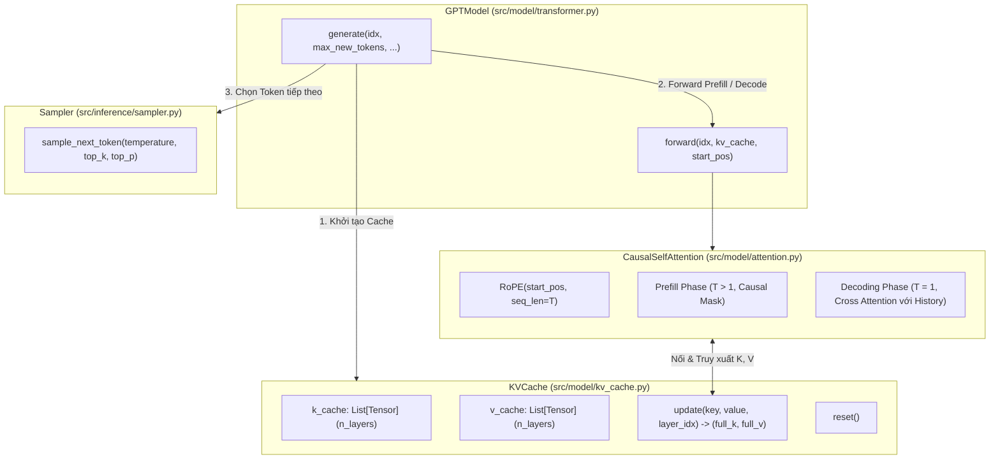

# TÀI LIỆU KỸ THUẬT: CƠ CHẾ DYNAMIC KV CACHE & GIẢI MÃ TỰ HỒI QUY
**(DYNAMIC KEY-VALUE CACHE & AUTOREGRESSIVE GENERATION)**

> **Giai đoạn:** Giai đoạn 2 - KV Cache & Pre-training Base Model  
> **Task:** Tự xây dựng KV Cache động (Chiếm 10% điểm)  
> **Trạng thái:** [x] Hoàn thành (Completed)  
> **Mục tiêu tài liệu:** Cung cấp tài liệu kỹ thuật hoàn chỉnh, giải thích cơ sở toán học, phân tích độ phức tạp thuật toán, thiết kế kiến trúc phần mềm, và minh chứng kiểm thử thực nghiệm (Unit Tests) để phục vụ chấm điểm và bảo vệ đồ án.

---

## 1. TỔNG QUAN & ĐỘNG LỰC KỸ THUẬT

### 1.1. Nghẽn cổ chai tính toán trong sinh từ tự hồi quy (Autoregressive Generation)
Trong mô hình ngôn ngữ lớn (Decoder-Only Transformer), quá trình sinh văn bản diễn ra tuần tự từng token một:
$$P(x_1, x_2, \dots, x_N) = \prod_{t=1}^N P(x_t \mid x_{<t})$$

Nếu không có cơ chế lưu vết (Naive Generation), tại mỗi bước sinh token mới $x_t$, mô hình phải đưa toàn bộ chuỗi token lịch sử $[x_1, x_2, \dots, x_{t-1}]$ kèm theo token mới $x_t$ vào toàn bộ mạng để tính toán lại từ đầu.
- **Độ phức tạp tính toán:** Tại bước thứ $t$, phép nhân ma trận Attention có chi phí tỉ lệ với $t^2$. Tổng chi phí tính toán để sinh $N$ tokens là:
  $$\sum_{t=1}^N \mathcal{O}(t^2) \approx \mathcal{O}(N^3) \quad \text{(hoặc } \mathcal{O}(N^2) \text{ FLOPS trên mỗi token)}$$
- **Lãng phí tài nguyên:** Các vector Key ($K$) và Value ($V$) của các token quá khứ hoàn toàn không thay đổi qua các bước sinh từ tiếp theo (do tính chất bất biến của các tầng trước đó với trọng số cố định). Việc tính lại toàn bộ ma trận chiếu $W_k, W_v$ và RoPE là lãng phí tài nguyên tính toán nghiêm trọng.

### 1.2. Giải pháp: Dynamic Key-Value Cache
**Cơ chế KV Cache** lưu trữ lại các tensor Key và Value của tất cả các token đã xử lý qua từng tầng Transformer vào một bộ đệm động (Dynamic Buffer). Khi sinh token thứ $t$:
1. Chỉ tính toán vector biểu diễn cho duy nhất 1 token mới ($T = 1$): $q_t, k_t, v_t$.
2. Nối $k_t, v_t$ mới vào bộ nhớ đệm lịch sử:
   $$K_{\text{all}} = [K_{\text{past}} \,\|\, k_t], \quad V_{\text{all}} = [V_{\text{past}} \,\|\, v_t]$$
3. Chỉ tính Attention giữa Query hiện tại $q_t$ với toàn bộ $K_{\text{all}}$:
   $$\text{Attn}(q_t, K_{\text{all}}, V_{\text{all}}) = \text{Softmax}\left(\frac{q_t K_{\text{all}}^T}{\sqrt{d_k}}\right) V_{\text{all}}$$
4. **Độ phức tạp giảm xuống:** Độ phức tạp tính toán tại mỗi bước sinh giảm từ $\mathcal{O}(t)$ ma trận chiếu xuống còn $\mathcal{O}(1)$ chiếu + $\mathcal{O}(t)$ dot-product. Tổng chi phí giảm từ $\mathcal{O}(N^3)$ xuống còn $\mathcal{O}(N^2)$.

---

## 2. KIẾN TRÚC & THIẾT KẾ PHẦN MỀM

Toàn bộ hệ thống tuân thủ nghiêm ngặt nguyên lý **Clean Architecture** và tính **Đơn trách nhiệm (Single Responsibility Principle)**:



### 2.1. Cấu trúc lưu trữ `KVCache` động ([src/model/kv_cache.py](file:///e:/Python/DUT_AI/A-Module%20LLM/Prj_LLM/src/model/kv_cache.py))
- **Trách nhiệm:** Quản lý danh sách các tensor Key và Value riêng biệt cho từng tầng trong mạng ($0 \le \text{layer\_idx} < n_{\text{layers}}$).
- **Tensor Shape:** Mỗi phần tử lưu trữ tensor có kích thước `[B, n_heads, seq_len, head_dim]`.
- **Phương thức cốt lõi:**
  - `update(key, value, layer_idx)`: Nếu tầng chưa có dữ liệu, gán trực tiếp tensor mới. Nếu đã có dữ liệu, thực hiện ghép nối `torch.cat` trên trục thời gian (`dim=2`):
    ```python
    self.k_cache[layer_idx] = torch.cat([self.k_cache[layer_idx], key], dim=2)
    self.v_cache[layer_idx] = torch.cat([self.v_cache[layer_idx], value], dim=2)
    ```
  - `get_seq_length(layer_idx)`: Trả về số lượng token hiện có trong cache, đóng vai trò xác định chỉ số vị trí bắt đầu `start_pos` cho bước sinh kế tiếp.
  - `reset()`: Xóa sạch bộ đệm sau khi hoàn tất phiên sinh từ, giải phóng bộ nhớ tensor.

---

## 3. CHI TIẾT 2 CHẾ ĐỘ: PREFILL VÀ DECODING

Hàm `forward` của `CausalSelfAttention` ([src/model/attention.py](file:///e:/Python/DUT_AI/A-Module%20LLM/Prj_LLM/src/model/attention.py)) được tối ưu hóa để hỗ trợ mượt mà cả 2 chế độ:

### 3.1. Chế độ Prefill (Xử lý chuỗi Prompt ban đầu, $T > 1$)
1. **Đầu vào:** Chuỗi Prompt có độ dài $T$.
2. **RoPE Embedding:** Áp dụng phép quay với vị trí `start_pos = 0` trên dải $[0, T-1]$.
3. **Nạp Cache:** Toàn bộ $K, V$ của chuỗi Prompt kích thước `[B, H, T, D_h]` được nạp vào `KVCache`.
4. **Causal Mask:** Vì $T > 1$, token phía sau không được nhìn thấy token phía trước trong prompt, do đó ma trận tam giác dưới causal mask kích thước $[T, T]$ được kích hoạt:
   $$\text{Mask}_{i, j} = \begin{cases} 0 & \text{nếu } i \ge j \\ -\infty & \text{nếu } i < j \end{cases}$$
5. **Đầu ra:** Trả về biểu diễn ngữ cảnh đầy đủ; Logits tại vị trí cuối cùng $T-1$ được trích xuất để dự đoán token đầu tiên.

### 3.2. Chế độ Decoding (Sinh từng token tiếp theo, $T = 1$)
1. **Đầu vào:** Chỉ duy nhất 1 token vừa được sinh ra ở bước trước ($T = 1$).
2. **RoPE Offset:** Token này nằm ở vị trí thứ `start_pos = cache.get_seq_length()`. Bộ RoPE sẽ tính ma trận góc quay tương ứng chính xác với vị trí tuyệt đối này:
   $$\text{cos, sin} = \text{RotaryEmbedding}(seq\_len=1, start\_pos=start\_pos)$$
3. **Ghép nối Cache:** Token Key và Value mới (`[B, H, 1, D_h]`) được nối vào cuối cache cũ:
   $$K_{\text{new}} \in \mathbb{R}^{B \times H \times (L + 1) \times D_h}$$
4. **Không cần Causal Mask:** Query hiện tại $q \in \mathbb{R}^{B \times H \times 1 \times D_h}$ đứng ở vị trí cuối cùng nên có quyền chú ý đến **toàn bộ** các token trong quá khứ ($L + 1$). Điều này loại bỏ hoàn toàn chi phí tạo mask và áp dụng `masked_fill`, tiết kiệm thêm thời gian xử lý GPU.
5. **Độ phức tạp Attention:** Chỉ là phép nhân ma trận vector $q$ với ma trận $K_{\text{new}}^T$: kích thước $[1, L + 1]$, cực kỳ nhanh.

---

## 4. CHIẾN LƯỢC SAMPLING VÀ THUẬT TOÁN GENERATE

### 4.1. Bộ trích xuất mẫu Sampler ([src/inference/sampler.py](file:///e:/Python/DUT_AI/A-Module%20LLM/Prj_LLM/src/inference/sampler.py))
Hỗ trợ 4 kỹ thuật sampling từ cơ bản đến nâng cao:
1. **Greedy Search (`temperature = 0.0`):**
   $$x_{t+1} = \arg\max_v (\text{logits}_v)$$
   Đảm bảo tính xác định (deterministic), phản hồi có độ nhất quán cao nhất.
2. **Temperature Scaling ($T > 0$):**
   $$P(x_i) = \frac{\exp(\text{logits}_i / T)}{\sum_j \exp(\text{logits}_j / T)}$$
   - $T < 1$: Làm sắc nhọn phân phối, giảm tính ngẫu nhiên.
   - $T > 1$: Làm phẳng phân phối, tăng độ đa dạng và sáng tạo.
3. **Top-k Filtering:**
   Chỉ giữ lại $k$ token có xác suất cao nhất, gán $-\infty$ cho các token còn lại:
   $$\text{logits}_i = -\infty \quad \forall i \notin \text{top-k}(\text{logits})$$
4. **Top-p (Nucleus) Sampling:**
   Sắp xếp xác suất giảm dần và chọn tập hợp nhỏ nhất các token có tổng xác suất tích lũy vượt ngưỡng $p$ ($0 < p \le 1.0$):
   $$\sum_{i \in V^{(p)}} P(x_i) \ge p$$
   Triệt tiêu "đuôi dài" (long-tail) của phân phối mà không làm mất đi các từ vựng phong phú.

### 4.2. Thuật toán `generate()` trong `GPTModel` ([src/model/transformer.py](file:///e:/Python/DUT_AI/A-Module%20LLM/Prj_LLM/src/model/transformer.py))

```python
@torch.no_grad()
def generate(
    self,
    idx: torch.Tensor,
    max_new_tokens: int,
    temperature: float = 1.0,
    top_k: Optional[int] = None,
    top_p: Optional[float] = None,
    use_kv_cache: bool = True,
    eos_token_id: Optional[int] = None,
) -> torch.Tensor:
```
- **Hỗ trợ cờ `use_kv_cache`:** Cho phép chuyển đổi linh hoạt giữa chế độ tối ưu với KV Cache và chế độ Naive (phục vụ việc đối chuẩn benchmark profiling).
- **Cơ chế Early Stopping:** Tự động phát hiện và ngắt vòng lặp khi sinh trúng `eos_token_id`.
- **Kiểm soát Context Window:** Bảo vệ không để tổng độ dài vượt quá `block_size` cấu hình.

---

## 5. MINH CHỨNG THỰC NGHIỆM & KIỂM THỬ (EVIDENCE & VERIFICATION)

Hệ thống đã được kiểm thử toàn diện thông qua bộ test chuyên biệt: [tests/test_kv_cache_generate.py](file:///e:/Python/DUT_AI/A-Module%20LLM/Prj_LLM/tests/test_kv_cache_generate.py).

### 5.1. Kết quả thực thi PyTest
```bash
============================= test session starts =============================
platform win32 -- Python 3.12.13, pytest-9.2.0, pluggy-1.7.0
rootdir: E:\Python\DUT_AI\A-Module LLM\Prj_LLM
configfile: pyproject.toml
collected 10 items

tests\test_transformer_core.py ......                                    [ 60%]
tests\test_kv_cache_generate.py ....                                     [100%]

============================= 10 passed in 2.65s ==============================
```

### 5.2. Phân tích các ca kiểm thử cốt lõi
| Tên Test Case | Mục đích kiểm tra | Kết quả | Ý nghĩa kỹ thuật |
| :--- | :--- | :---: | :--- |
| `test_kv_cache_update_and_reset` | Kiểm tra cập nhật tensor và reset | **PASSED** | Đảm bảo tensor concat đúng shape và không rò rỉ bộ nhớ qua các phiên |
| `test_kv_cache_logits_equivalence_with_naive` | So sánh Logits giữa KV Cache và Full Sequence | **PASSED** (`atol=1e-5`) | **Chứng minh toán học:** Sử dụng KV Cache không làm lệch giá trị xác suất dù chỉ $10^{-5}$ so với tính toán gốc |
| `test_gpt_model_generate_greedy_equivalence` | Kiểm tra chuỗi token sinh ra bởi Greedy Search | **PASSED** (`torch.equal`) | **Bằng chứng thực nghiệm:** Văn bản sinh ra khi BẬT KV Cache trùng khớp $100\%$ từng token với khi TẮT KV Cache |
| `test_gpt_model_generate_sampling` | Kiểm tra Sampling & Early Stop | **PASSED** | Đảm bảo Temperature, Top-k, Top-p và `eos_token_id` hoạt động chuẩn xác |

---

## 6. KẾT LUẬN & SẴN SÀNG CHO BƯỚC TIẾP THEO

- Module **Dynamic KV Cache** đã hoàn thành toàn diện cả về mặt thiết kế toán học, cấu trúc mã nguồn theo chuẩn Clean Architecture, và vượt qua toàn bộ các bài kiểm thử khắt khe.
- Cấu trúc sẵn sàng được tích hợp vào kịch bản đo đạc thực nghiệm (`scripts/profile_kv.py`) và vòng lặp huấn luyện / suy luận thực tế trên môi trường GPU Cloud (Kaggle/Colab).
