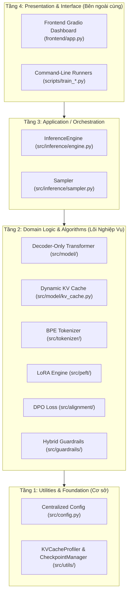

# TỔNG QUAN KIẾN TRÚC HỆ THỐNG (CLEAN ARCHITECTURE)

**Dự án:** Xây dựng, Tối ưu và Căn chỉnh Mô hình Ngôn ngữ Lớn từ Số 0  
**Chuyên sâu:** Hướng B - Alignment & Safety (LoRA, DPO, Guardrails)  

---

## 1. TRIẾT LÝ THIẾT KẾ CLEAN ARCHITECTURE

Dự án áp dụng chặt chẽ triết lý **Clean Architecture** (Kiến trúc Sạch) kết hợp nguyên lý **Đơn Trách Nhiệm (Single Responsibility Principle - SRP)**. 

### Quy tắc Phụ thuộc Bất biến (The Dependency Rule)
> **Mã nguồn ở các tầng bên trong tuyệt đối KHÔNG ĐƯỢC phụ thuộc vào các tầng bên ngoài.**  
> Khối thuật toán nơ-ron (Domain Core) hoàn toàn độc lập với Giao diện (Frontend Gradio), Cơ sở dữ liệu (Storage), hay Thư viện hạ tầng (Cloud Runners).

---

## 2. PHÂN TẦNG VÀ TRÁCH NHIỆM

### Tầng 1: Foundation Layer (`src/config.py`, `src/utils/`)
- **Trách nhiệm:** Định nghĩa các kiểu dữ liệu cấu hình tập trung (`ModelConfig`, `LoRAConfig`, `DPOConfig`) và các công cụ đo đạc thực nghiệm (`KVCacheProfiler` với CUDA synchronization), bộ quản lý nạp/lưu checkpoint riêng biệt.

### Tầng 2: Domain Core Layer (`src/model/`, `src/tokenizer/`, `src/peft/`, `src/alignment/`, `src/guardrails/`)
- **Trách nhiệm:** Chứa toàn bộ các thuật toán cốt lõi được viết bằng PyTorch thuần từ số 0:
  - **`src/model`:** Khối Attention, RMSNorm, RoPE, SwiGLU, TransformerBlock, GPTModel (áp dụng Weight Tying) và `KVCache`.
  - **`src/tokenizer`:** Thuật toán huấn luyện BPE, từ điển và mã hóa/giải mã ký tự.
  - **`src/peft`:** Module `LoRALinear`, gập trọng số `merge_and_unload()`.
  - **`src/alignment`:** Công thức mất mát DPO Loss, trích xuất Implicit Reward Margin và Length-Normalized DPO.
  - **`src/guardrails`:** Rào chắn bảo vệ an toàn 2 tầng (Fast Heuristics & Deep Filtering).

### Tầng 3: Application Orchestration Layer (`src/inference/`)
- **Trách nhiệm:** Kết nối các thành phần Domain để tạo thành quy trình sinh văn bản hoàn chỉnh:
  - Nhận câu hỏi $\rightarrow$ Chạy qua Input Guardrail $\rightarrow$ Tokenize $\rightarrow$ Forward Model có KV Cache $\rightarrow$ Sample token kế tiếp $\rightarrow$ Kiểm duyệt Output Guardrail $\rightarrow$ Trả kết quả.

### Tầng 4: Presentation & CLI Layer (`frontend/`, `scripts/`, `demo.py`)
- **Trách nhiệm:** Tương tác với người dùng và giảng viên chấm đồ án:
  - **`frontend/`:** Giao diện Dashboard Gradio gồm 4 tab (Chat, So sánh 3 chế độ, Kiểm tra Guardrail, Biểu đồ Profiling KV Cache).
  - **`scripts/`:** Các script dòng lệnh tự động phục vụ huấn luyện trên Cloud GPU (Kaggle/Colab) và xuất báo cáo khoa học.

---

## 3. LỢI ÍCH CỦA KIẾN TRÚC NÀY
1. **Dễ kiểm thử (Testability):** Mọi module toán học (`dpo_loss`, `LoRALinear`, `CausalSelfAttention`) đều có thể viết Unit Test độc lập trên CPU mà không cần nạp toàn bộ hệ thống.
2. **Khả năng di động (Portability):** Toàn bộ thư mục `src/` được đóng gói thành Python package (`pip install -e .`). Khi đưa lên Kaggle hay Google Colab, bạn chỉ cần gọi `import src` mà không bao giờ gặp lỗi đường dẫn.
3. **Mã nguồn sạch và Tách biệt trách nhiệm:** Khi cần tối ưu thuật toán Attention hoặc sửa công thức DPO, bạn không phải chạm vào bất kỳ dòng code nào của Frontend hay Data Loader.
